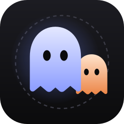

<h1 align="center">Ghost Walk: a quantum ghost hunt</h1>

<p align="center">
  
</p>

<p align="center">
  <a href="https://ghost.yogourt.dev"></a>
  <picture></picture>
  <a href="docs/real-chip.md"></a>
  <picture></picture>
  <a href="LICENSE"></a>
</p>

Hunt a quantum ghost that is spread over sixteen rooms at once. The ghost is a discrete-time quantum walk written in Qiskit, every flashlight is a projective measurement, and the same walk ran on **ibm_kingston**, a 156-qubit IBM Heron quantum computer.

Built for **Qiskit Fall Fest 2026 Warsaw**, Track 3: quantum games.

| | |
|---|---|
| Game | React + TypeScript in [`web/`](web/), plays instantly in the browser: **https://ghost.yogourt.dev** |
| Online group play | A room of phones votes where to shine the flashlight; the ghost lives in a self-hosted [Convex](https://convex.dev) backend ([`web/convex/`](web/convex/)) |
| Quantum walk | Qiskit module [`quantum_walk.py`](quantum_walk.py) |
| Real hardware | [`run_on_ibm.py`](run_on_ibm.py), two jobs on ibm_kingston, every shot saved in [`hardware/`](hardware/) |
| Tutorial notebook | [`ghost_walk_tutorial.ipynb`](ghost_walk_tutorial.ipynb): build the ghost, the flashlight and the hardware circuit step by step |
| Docs | [How it works](docs/how-it-works.md) · [Real-chip run](docs/real-chip.md) · [Original plan](ghost-walk.md) |

---

## The game

A ghost hides in a corridor of 16 rooms that loops back on itself. It is a quantum ghost: it is not in one room but spread over many, it moves like a wave, and its waves can cancel each other out. You have five flashlights.

1. **Read the ghosts.** Each room shows your exact chance of catching the ghost there. The ghost started in room 8 and has already taken seven steps.
2. **Search a room.** Click it. If the ghost is there, you win. If not, that room empties and every other room grows, because the ghost must be somewhere else.
3. **Watch it move.** The ghost steps one room left and one room right at the same time. Where its waves meet they add up or cancel, so the next picture is not what a coin-flipping ghost would give.
4. Run out of flashlights and the ghost escapes.

The player never sees a circuit or an equation. Qiskit is the physics engine underneath.

**Tuned to be winnable, but not by luck.** A simulation over the game's own engine ([`web/scripts/simulate.ts`](web/scripts/simulate.ts), `npm run simulate`) plays every hunt exactly for "always search the most likely room" and 200 000 times at random:

| Rules | Quantum: best room | Quantum: random room* | Coin-flip: best room | Coin-flip: random room* |
|---|---|---|---|---|
| Before: 4 flashlights, 3 warm-up steps | 88.3 % | 62.8 % | 81.3 % | 63.0 % |
| Then: 4 flashlights, 7 warm-up steps | 64.0 % | 41.3 % | 68.5 % | 41.3 % |
| **Now: 5 flashlights, 7 warm-up steps** | **71.1 %** | **48.6 %** | **74.7 %** | **48.6 %** |

\* a random room that can still hold the ghost; any of the 16 rooms at random wins 28 %.

With three warm-up steps the ghost sat in only four rooms, so good play nearly always won and the choices hardly mattered. After seven steps it covers eight rooms, the quantum ghost already shows its two peaks running apart, good play wins about two hunts in three, and it beats random play by 23 points. More flashlights were not the fix for that: at 3 warm-up steps even 4 flashlights win 88 % for good play. With 7 warm-up steps the hunt then felt too hard for new players, so a fifth flashlight lifts good play to 71–75 % and random play to about half, still 22–26 points apart. The quantum ghost is the harder one (71 % against 75 %), because it runs away faster. Solo and group play use the same rules ([`web/src/game/rules.ts`](web/src/game/rules.ts)).

**Also in the game**

- **Play online** (next to Docs on the hunt): the hunt as a room vote, built for a showcase. The big screen shows a QR code, a four-digit game code and the ring with live vote counts; 30–100 people join on their phones and vote for the room to search each turn. When the countdown ends (or the host closes the vote) the most-voted room gets the flashlight, a tie is drawn at random, and the ghost steps. The ghost's amplitudes, every flashlight and every random roll live on the server, so every screen sees the same ghost and nobody can cheat from a phone. Details in [web/README.md](web/README.md#online-group-play).
- **Tutorial** (`#/tutorial`): seven short screens. The ghost starts alone in room 1, splits left and right, and at step four the waves cancel. Ends with a practice flashlight.
- **Quantum / coin-flip toggle**: the same hunt with a classical random-walk ghost, so players can feel the difference.
- **Fog**: hides the chances, so you have to predict where the waves went.
- **"What happened" log**: one line after every turn, e.g. *"Waves cancelled in room 8. A coin-flipping ghost would be there 38% of the time; this one, 13%."*
- **Real-chip round** (`#/docs`, section *Real chip*): one flashlight against a ghost that walked 5 steps on ibm_kingston. Where it is comes from one of the 2000 real measurements. Then step through the whole run, see how noise leaks the ghost, and compare the two jobs.

## Where the quantum part is

| Quantum idea | In the game |
|---|---|
| Superposition | The ghost is in many rooms at once. |
| Measurement and collapse | A flashlight asks "is the ghost here?". A miss removes that room from the ghost and the rest is renormalised. |
| Interference | Every route the ghost can take carries a sign. From step four, routes back to the start cancel and the ghost splits into two groups running apart. |
| Decoherence | On real hardware the signs wash out and the ghost leaks into rooms a perfect ghost can never reach. Measured on ibm_kingston. |

After four steps, starting from room 8:

| Room | 4 | 6 | 8 | 10 | 12 |
|---|---|---|---|---|---|
| Coin-flipping ghost | 6 % | 25 % | **38 %** | 25 % | 6 % |
| Quantum ghost | 6 % | **38 %** | 13 % | **38 %** | 6 % |

The coin-flipping ghost is most likely back in the middle. The quantum ghost avoids it. Over time the quantum ghost spreads in proportion to the number of steps, the classical one only to its square root.

## Results on a real quantum computer

Two jobs on **ibm_kingston**, 23 October 2026, 2000 shots per circuit. Total QPU time 19 s.

| Job ID | Circuits | Queue | QPU time |
|---|---|---|---|
| `dbdqmq7gdj9s73fko830` | 8- and 16-room rings, 1–8 steps each | 3 s | 11 s |
| `dbdqq5nsstms73fb1c2g` (rerun) | 16 rooms 1–8, 8 rooms 6–7, on other qubits | 1 s | 8 s |

**The 8-room ring stays quantum.** After 5 steps the ideal quantum ghost sits in rooms 1 and 7 (38 % each), a coin-flipping ghost in rooms 3 and 5 (31 % each). The chip put 32 % and 34 % in rooms 1 and 7. Its distance from the quantum ghost is 0.10, from the coin-flipping ghost 0.37.

**The 16-room ring decoheres.** It needs about four times more two-qubit gates per step. By step 3 the real ghost is closer to "evenly spread over all rooms" than to the quantum ghost, and up to 29 % of it sits in rooms a perfect ghost can never be in.

**Noise does not make the ghost classical.** It leaks the ghost into every room and flattens it, which is a different picture from the classical bell curve.

Full method, tables and lessons (including why the same circuit on other qubits gave a different ghost): [docs/real-chip.md](docs/real-chip.md).

## Quick start

### Play

Needs Node.js 22 or newer.

```bash
cd web
npm install
npm run dev
```

Open http://localhost:5173. `npm run build` writes a static site to `web/dist/` that can be hosted anywhere.

### Play online (group mode)

Needs a Convex backend. Locally, in `web/`: `npx convex dev` (choose to run Convex locally, no account needed), then `npm run dev` in a second terminal, and click **Play online**. Open the join link on another device or tab. The live site runs on a self-hosted Convex; setup and redeploy (`npm run deploy`) are in [web/README.md](web/README.md).

### Python: the walk, the notebook, a local noisy run

Needs Python 3.11 or newer.

```bash
python -m venv .venv
.venv/bin/pip install -r requirements.txt          # Windows: .venv\Scripts\pip
```

```python
from quantum_walk import ghost_walk, ideal_probs, classical_probs

ideal_probs(4)       # room probabilities of the quantum ghost after 4 steps, 16 rooms
classical_probs(4)   # the coin-flipping ghost
ghost_walk(5, 3)     # the circuit: 8-room ring, 5 steps, room register measured
```

Open [`ghost_walk_tutorial.ipynb`](ghost_walk_tutorial.ipynb) in Jupyter or VS Code for the guided version.

The whole hardware pipeline also runs on a local noisy simulator of an IBM chip, no account needed:

```bash
python run_on_ibm.py submit --fake        # results in hardware/results_fake.json
```

### Run it on a real IBM quantum computer

Needs an [IBM Quantum Platform](https://quantum.cloud.ibm.com) account saved with `QiskitRuntimeService.save_account(...)`. The free Open Plan gives 10 minutes of QPU time per 28 days; one full job costs about 10 s.

```bash
python run_on_ibm.py submit --backend ibm_kingston --dry-run   # print the plan, send nothing
python run_on_ibm.py submit --backend ibm_kingston --tag mine  # one job; id saved to hardware/job_mine.json
python run_on_ibm.py fetch --tag mine --wait                   # results to hardware/results_mine.json
cd web && npm run sync-data                                    # show results.json / results_rerun.json in the game
```

`--circuits 16:1-8 8:6-7` picks ring sizes and step ranges, `--avoid 17 25` keeps qubits out, `--shots` sets the shot count.

## How it works

The ghost is a discrete-time quantum walk on a ring. Room number in 4 qubits (16 rooms) or 3 qubits (8 rooms), plus one coin qubit. One step is a Hadamard on the coin, then "coin 0 moves left, coin 1 moves right". The start coin (|0⟩ + i|1⟩)/√2 makes the walk symmetric.

Two pieces of engineering made it work:

- **A shift that fits on a chip.** The textbook shift (controlled +1, controlled −1) compiles to 458 two-qubit gates per step. We write it as "everyone −1, then +2 if the coin is 1". Same unitary, checked exactly, but +2 never touches the lowest room bit, so the controlled adder is one qubit smaller: 60 two-qubit gates per step.
- **An engine that answers every click instantly.** The game runs the same walk in the browser ([`web/src/engine/walk.ts`](web/src/engine/walk.ts)), storing one complex amplitude per room and coin. It matches Qiskit's statevector to 2 × 10⁻¹⁵ for both rings and 0–8 steps. Real hardware is used for the finale, not for clicks, because of queue times and QPU quota.

Details, circuits and the flashlight as an ancilla measurement: [docs/how-it-works.md](docs/how-it-works.md).

## Repository layout

```
quantum_walk.py              the ghost as Qiskit circuits, plus exact quantum and classical probabilities
run_on_ibm.py                build, transpile, re-layout, submit one job, fetch and score results
ghost_walk_tutorial.ipynb    "Build a quantum ghost in Qiskit", executed, with real-chip plots
requirements.txt             Python dependencies
hardware/
  job.json, results.json                 first ibm_kingston job: every shot, ideal / classical / real bars
  job_rerun.json, results_rerun.json     rerun on other qubits
  job_fake.json, results_fake.json       same pipeline on a local noisy FakeTorino
web/                         the game and in-app docs (React, Vite, TypeScript)
  src/engine/walk.ts         the quantum walk and the flashlight measurement
  src/game/rules.ts          flashlights, warm-up steps, vote times: shared by solo, group play and the simulation
  src/game/hunt.ts           turn logic and "what happened" explanations
  src/views/                 start screen, hunt, tutorial, docs, real-chip round, host screen, phone
  src/online/                Convex client, Play online button, saved seats
  src/data/chip.json         real-chip results, synced from hardware/ by npm run sync-data
  convex/                    group play on the server: schema, game codes, votes, the turn engine, expiry
  scripts/                   simulate.ts (win rates), codes-test.ts, crowd-test.ts (100 phones), deploy.mjs
docs/
  how-it-works.md            the physics and the circuits
  real-chip.md               the hardware run: method, results, lessons
ghost-walk.md                the plan written at the start of the hackathon
```

## What is done

| Feature | Status |
|---|---|
| Quantum walk circuit, 8 and 16 rooms | done |
| Hunt with flashlight measurements, 16-room ring | done |
| Quantum / coin-flip toggle | done |
| "What happened" explanations | done |
| Tutorial | done |
| Fog mode | done |
| Real-chip run and real-chip round | done, two jobs on ibm_kingston |
| Tutorial notebook | done |
| Noise slider (simulator with a real chip's noise model) | not built; the real-chip section shows measured noise instead |
| Audience voting (online group play, QR join, server-side ghost) | done, live at https://ghost.yogourt.dev |
| Rules tuned by simulation | done: 7 warm-up steps, 5 flashlights, good play wins 71–75 % |

## Related work

| Project | Difference |
|---|---|
| [Schrödinger cat and hounds](https://iopscience.iop.org/article/10.1088/0031-9120/47/3/346) (Gordon & Gordon, 2012) | Quantum board game; not a measurement hunt on a quantum walk. |
| [Qubit the Barbarian](https://exca.itch.io/qubit-the-barbarian) | Dungeon game with measurement; different mechanic. |

New here: a flashlight that is a partial yes/no measurement which reshapes the wave and so changes all future interference, a side-by-side classical ghost, and the same game state measured on real IBM hardware with every shot published.

## Licence

[MIT](LICENSE).
